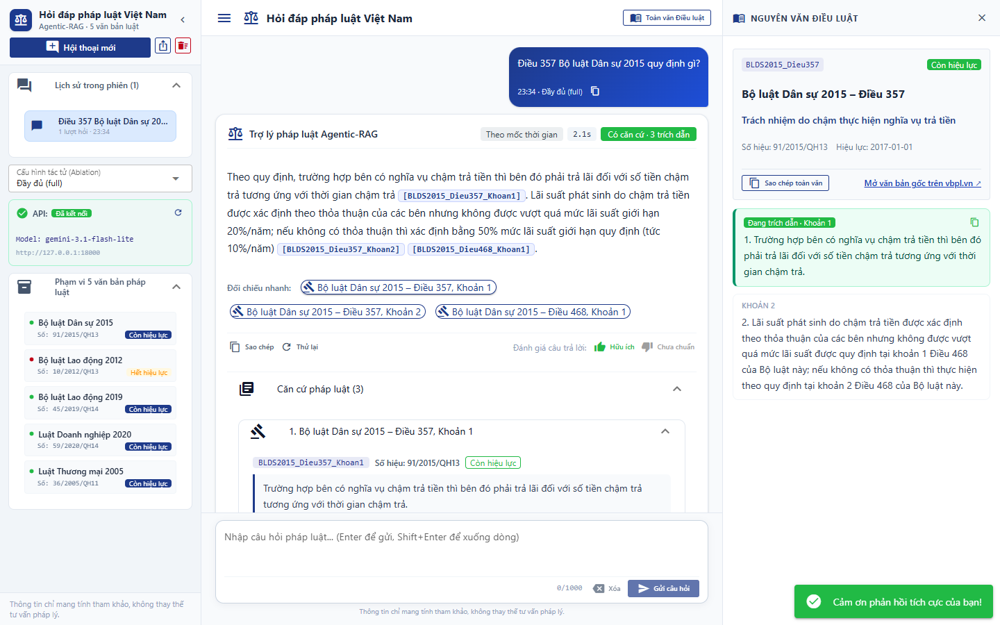

# vn-legal-qa

**Phát triển hệ thống hỏi đáp pháp luật Việt Nam dựa trên Agentic-RAG với truy xuất căn cứ theo hiệu lực và kiểm chứng trích dẫn** (Đồ án CNTT ĐA127, Trường Đại học Tôn Đức Thắng; GVHD: PGS.TS. Lê Anh Cường; sinh viên: Phạm Huỳnh Quốc Đạt, Hoàng Sinh Hùng).

Hệ thống trả lời câu hỏi pháp luật tiếng Việt trên 5 văn bản (BLDS 2015, BLLĐ 2019, BLLĐ 2012, LDN 2020, LTM 2005). Căn cứ được truy xuất theo đúng phiên bản còn hiệu lực tại thời điểm sự việc, và mọi trích dẫn được kiểm chứng trước khi trả về.



Muốn chạy thử: xem mục 1. Muốn sửa code: mục 2. Muốn tái lập số liệu trong báo cáo: mục 4 (không cần API key cho các bảng).

## 1. Chạy nhanh bằng Docker

**Cần:** Docker có Compose; RAM trống từ 4 GB (API đo được khoảng 1,5 GB, nạp chỉ mục cần nhiều hơn; trên Docker Desktop, kiểm tra hạn mức RAM trong Settings); đĩa trống khoảng 12 GB (image 3,2 GB, mô hình tối đa khoảng 7 GB); một API key Gemini miễn phí từ [aistudio.google.com](https://aistudio.google.com).

```bash
cp .env.example .env               # điền LLM_API_KEY; JUDGE_* chỉ cần khi chấm lại thực nghiệm
mkdir -p .cache/llm                # tạo trước, nếu không Docker sẽ tạo thư mục này dưới quyền root
unzip chroma_db.zip                # file nộp kèm repo (73 MB, đủ 4 chỉ mục): chép vào thư mục gốc repo, giải nén ra chroma_db/
docker compose up --build          # --build để image luôn khớp code sau mỗi lần git pull; không đổi gì thì chỉ mất vài giây
```

Windows PowerShell:

```powershell
Copy-Item .env.example .env
mkdir .cache/llm -Force
Expand-Archive chroma_db.zip -DestinationPath .
docker compose up --build
```

Không có `chroma_db.zip` thì tạo thư mục `chroma_db` rồi tự nạp, khoảng 2 giờ trên CPU, trước khi `up`:

```bash
docker compose run --rm api python -m src.ingestion.index --variant clause_header --rebuild
```

- Giao diện: <http://localhost:8080>. API: <http://localhost:8000> (tài liệu ở `/docs`). Hai cổng chỉ mở trên máy này. Giao diện khởi động sau khi API sẵn sàng; khi đã có sẵn mô hình, mất khoảng 1 phút.
- **Lần chạy đầu tải tối đa khoảng 7 GB mô hình** (BGE-M3, bge-reranker-v2-m3) vào `~/.cache/huggingface` của máy, nên có thể mất nhiều phút, mạng chậm có thể hơn một giờ; các lần sau dùng lại. Đặt `HF_CACHE=<thư mục>` nếu muốn lưu ở chỗ khác.
- Thiếu chỉ mục hoặc thiếu key thì container `api` dừng, cuối log nêu rõ việc cần làm. Xem bằng `docker compose logs api`.
- Câu hỏi thử: "Điều 357 Bộ luật Dân sự 2015 quy định gì?". Gemini miễn phí đôi khi báo quá tải (503): đợi vài phút rồi hỏi lại.
- Trên Linux, container chạy bằng root nên file nó tạo ra thuộc root. Nếu dùng song song với cài đặt ở mục 2, chạy một lần: `sudo chown -R "$(id -u):$(id -g)" chroma_db .cache ~/.cache/huggingface`.

## 2. Cài đặt cho phát triển

Cần Python 3.14.

```bash
python -m venv .venv && source .venv/bin/activate   # fish: source .venv/bin/activate.fish; PowerShell: .venv\Scripts\Activate.ps1
pip install torch==2.14.1 --index-url https://download.pytorch.org/whl/cpu   # cài trước, bản mặc định kéo theo CUDA nặng vài GB
pip install -r requirements.txt
cp .env.example .env                                # điền LLM_API_KEY
pytest -q                                           # không cần key, mô hình hay chỉ mục

uvicorn src.api.main:app --port 8000                # API, cần chroma_db/ (giải nén như mục 1 hoặc nạp như mục 3)
python -m src.ui.web.main                           # giao diện, http://127.0.0.1:8080
python -m src.agent.run "Bên mua trả tiền chậm có phải trả lãi không?"   # hỏi tác tử từ dòng lệnh
```

Bật API trước giao diện. Nếu không nối được API, giao diện tự chuyển sang chế độ dự phòng mà vẫn hiện "Đã kết nối": có key thì tác tử chỉ truy xuất bằng BM25, không có key thì dùng câu trả lời ghi sẵn. Số liệu trong báo cáo không áp dụng cho chế độ này; kiểm API bằng `curl localhost:8000/health`, hoặc đặt `UI_LOCAL_FALLBACK=0` để giao diện báo lỗi thay vì chuyển dự phòng (Docker đã đặt sẵn).

Biến môi trường: xem `.env.example`. Quy ước code, quy tắc sửa tập kiểm thử và prompt: `AGENTS.md`.

## 3. Dữ liệu và chỉ mục

`data/processed/` (chunk) và `eval/test_cases.json` (tập kiểm thử) có sẵn trong repo. Chỉ chạy lại các lệnh sinh dữ liệu khi sửa nguồn:

```bash
python -m src.ingestion.legal_chunker   # data/structured/*.json -> data/processed/chunks*.jsonl
python -m eval.import_cases             # manual + zalo + synthetic -> eval/test_cases.json
```

Chỉ mục ChromaDB nằm trong `chroma_db/`. File `chroma_db.zip` nộp kèm đã có đủ 4 chỉ mục, nên các lệnh dưới chỉ cần khi không có file đó hoặc đã sửa chunk (dùng Docker thì thêm `docker compose run --rm api` phía trước):

```bash
python -m src.ingestion.index --variant clause_header --rebuild   # bắt buộc cho ứng dụng và RQ1
python -m src.ingestion.index --variant clause_plain --rebuild    # 3 biến thể dưới chỉ cần cho RQ2
python -m src.ingestion.index --variant article --rebuild
python -m src.ingestion.index --variant fixed --rebuild
```

| Biến thể | Đơn vị phân đoạn | Số chunk | Thời gian nạp ước tính trên CPU* |
|---|---|---:|---:|
| `clause_header` | Khoản, có gắn tiêu đề khi embed | 4.853 | khoảng 2 giờ |
| `clause_plain` | Khoản, không gắn tiêu đề | 4.853 | khoảng 2 giờ |
| `article` | Điều | 1.693 | khoảng 40 phút |
| `fixed` | Cửa sổ cố định 200 từ | 1.679 | khoảng 40 phút |

\* Ước tính từ tốc độ đo được khoảng 1,4 giây/chunk trên một mẫu 64 chunk (máy của nhóm, không có GPU).

## 4. Tái lập thực nghiệm

Kết quả thô đã có sẵn trong `eval/results/*.jsonl`. **Các lệnh ở bảng dưới (trừ RQ1, RQ2) chỉ đọc các file đó: không cần key, không gọi LLM, không cần chỉ mục**, chạy trong vài giây và ra đúng số liệu đang có trong repo. Lệnh tính từ thư mục gốc, trong môi trường ở mục 2.

| Trong báo cáo | Lệnh | File kết quả |
|---|---|---|
| Bảng 4.1 (tập kiểm thử) | `python -m eval.import_cases` | `eval/test_cases.json` |
| Bảng 4.2, RQ1 | `python -m eval.evaluate --rq rq1` (cần chỉ mục, khoảng 1 giờ CPU) | `eval/results/retrieval_rq1.md` |
| Bảng 4.3, RQ2 | `python -m eval.evaluate --rq rq2` (cần 4 chỉ mục, khoảng 1 giờ CPU) | `eval/results/retrieval_rq2.md` |
| Bảng 4.4, 4.5, RQ3 | `python -m eval.agent_eval report --rq rq3 --common --ci --out eval/results/agent_rq3_ablation209.md` | `eval/results/agent_rq3_ablation209.md` |
| Bảng 4.6, 30 câu giữ riêng | `python -m eval.agent_eval report --rq rq3 --subset 30 --common --ci --out eval/results/agent_rq3_heldout30.md` | `eval/results/agent_rq3_heldout30.md` |
| Bảng 4.7, phép thử kiểm chứng | `python -m eval.verify_attack report` | `eval/results/verify_attack.md` |
| Bảng 4.8, độ trễ | `python -m eval.agent_eval report --rq rq3 --subset 20 --tag latency --latency --out eval/results/agent_rq3_latency.md` | `eval/results/agent_rq3_latency.md` |
| Bảng 4.9, 4.10, RQ4 | `python -m eval.agent_eval report --rq rq4 --common --ci --out eval/results/agent_rq4.md` | `eval/results/agent_rq4.md` |
| Bảng 4.10, 20 câu giữ riêng | `python -m eval.agent_eval report --rq rq4 --subset 20 --common --ci --out eval/results/agent_rq4_heldout20.md` | `eval/results/agent_rq4_heldout20.md` |
| Bảng 4.11, phân tích lỗi | `python -m eval.error_analysis report` | `eval/results/errors_rq3.md` |
| Tỷ lệ khớp người–bộ chấm | `python -m eval.agent_eval agree --rq rq3 --filled eval/results/grading_rq3_dat.csv` | in ra màn hình |
| Hình 4.1–4.4 | `python -m eval.plots` | `docs/report/figures/*.png` |

`eval/results/v1_vs_v2.md` (so sánh hai phiên bản verify) được lập một lần từ `eval/results/v1_verify_strict/`, không có lệnh sinh tự động; code của bản v1 nằm trong lịch sử git.

**Chạy lại từ đầu** (cần key, tốn quota). Lệnh `run` bỏ qua câu đã có kết quả, nên muốn chạy lại phải xóa dòng tương ứng trong JSONL (xem `AGENTS.md`). Hết quota thì lệnh tự dừng, chạy lại cùng lệnh là tiếp đúng chỗ:

```bash
python -m eval.agent_eval run --rq rq3      # 5 cấu hình x 209 câu, khoảng 3.000 lượt gọi Gemini
python -m eval.agent_eval run --rq rq4      # 3 chính sách x 32 câu, khoảng 420 lượt
python -m eval.agent_eval judge --rq rq3    # chấm bằng Groq (JUDGE_*)
python -m eval.agent_eval judge --rq rq4
python -m eval.verify_attack run            # phép thử kiểm chứng
```

- Quota miễn phí: Gemini 500 lượt/ngày/key, nên RQ3 + RQ4 mất khoảng 7 ngày với một key; Groq khoảng 100 lượt chấm/ngày/key.
- Cache LLM trong `.cache/llm/` (không nằm trong git) khiến đầu vào trùng khớp không tốn quota, nhưng chỉ có tác dụng trên máy đã chạy trước đó.
- Đo độ trễ cần thêm cờ riêng, mỗi cấu hình một thư mục cache mới: lệnh trong docstring `eval/agent_eval.py`.
- Câu trả lời của LLM không tất định: chạy lại từ đầu sẽ cho số gần với báo cáo chứ không trùng khớp.

## 5. Cấu trúc thư mục

```
src/ingestion/    phân đoạn văn bản, nạp ChromaDB (4 biến thể)
src/retrieval/    BM25, dense, RRF, reranker, lọc theo ngày hiệu lực
src/generation/   client LLM có cache, prompt, xử lý trích dẫn
src/agent/        đồ thị LangGraph: route, lookup_article, retrieve, grade, generate, verify
src/api/          FastAPI: POST /api/ask, GET /api/article/{law_id}/{article}, GET /health
src/ui/web/       giao diện NiceGUI (chính)
src/ui/app.py     giao diện Streamlit (bản đầu)
eval/             tập kiểm thử, chỉ số, bộ chấm, chạy và báo cáo thực nghiệm
eval/results/     kết quả thô (JSONL) và bảng số liệu (Markdown)
data/             văn bản luật (raw, structured) và chunk (processed)
tests/            pytest
docs/             đề cương, thiết kế, kế hoạch sprint, bản nháp báo cáo
```

Tài liệu liên quan: `AGENTS.md` (bối cảnh, quy tắc, lệnh thường dùng); `docs/managements/Đề cương DACNTT.md` (đề cương, Phụ lục A: định dạng dữ liệu và API); `docs/superpowers/specs/2026-10-09-agentic-legal-qa-design.md` (thiết kế); `docs/report/` (báo cáo).
